# LSMIO Test Subsystem Guide

The LSMIO test subsystem provides automated verification spanning C++ unit tests, extended storage stress tests, MPI multi-rank integration tests, and Python toolchain test suites.

For top-level architecture and subsystem navigation, refer to the [LSMIO Architecture Guide](../README.md).  
For benchmark execution and CLI flag options, see the [Benchmark Guide](../benchmark/README.md).  
For cluster orchestration and parsing tools, see the [Tools & Orchestration Guide](../tools/README.md).

---

## 1. Test Architecture & Frameworks

The testing harness combines CMake CTest orchestration with GoogleTest and Python `unittest`:

```mermaid
graph TD
    A["CTest Orchestrator (build.sh test / xtest)"] --> B["GoogleTest C++ Unit & Store Tests"]
    A --> C["GoogleTest Extended Stress Tests"]
    A --> D["MPI Multi-Rank Tests (mpirun / srun / aprun)"]
    A --> E["Python Toolchain Tests (lsmiotool test)"]
    A --> F["Staged Installation Smoke Tests"]

    B --> B1["test_memtable"]
    B --> B2["test_sstable_manager"]
    B --> B3["test_store_native"]
    B --> B4["test_file_pool / test_file_closer"]
    B --> B5["test_posix / test_manager"]

    C --> C1["test_native_extended"]
    C --> C2["test_leveldb / test_rocksdb"]
    C --> C3["test_adios / test_plugin"]

    D --> D1["test_mpi_base"]
    D --> D2["test_mpi_manager"]
    D --> D3["test_mpi_adios"]
    D --> D4["test_mpi_bm_base / benchmarkMPI entries"]

    E --> E1["VariantCatalogueTest"]
    E --> E2["Run / Parse / Compare Tests"]
    E --> E3["Resource & Staging Tests"]
```



### 1.1 CTest Orchestration
- Managed via CMake in `test/CMakeLists.txt`.
- Supports multi-core parallel test execution (`ctest -j8`).
- Injects required runtime environments per test:
  - `LD_LIBRARY_PATH`: Points to `build/lib` for dynamic shared libraries.
  - `ADIOS2_PLUGIN_PATH`: Directs ADIOS2 tests to `build/lib` for plugin discovery.
  - `PYTHONPATH`: Adds `tools/` for `lsmiotool` test modules.
  - `LSMIO_ENV=DEV`: Configures fake scheduler/worker paths for Python integration tests.

### 1.2 GoogleTest C++ Framework
- Defined using `add_lsmio_base_test`, `add_lsmio_store_test`, and `add_lsmio_mpi_test` CMake functions.
- MPI tests are registered using `gtest_discover_tests` with an auto-detected MPI launcher (`mpirun`, `aprun`, `likwid-mpirun`, or `srun`).

### 1.3 Python `unittest` Suite
- Python tests in `tools/lsmiotool/test/` are discovered dynamically via `_discoverTestModuleNames()`.
- Each test module is registered as a discrete CTest target (e.g., `lsmiotool.main.VariantCatalogueTest`) for fine-grained execution and status reporting.

---

## 2. Test Execution Commands

All tests should be run through `./build.sh` or `ctest`.

### 2.1 Standard Test Execution

```bash
# Compile and run default test suite
./build.sh test

# Run one binary's tests (builds just that target; keep the regex anchored to
# its tests, since other binaries are not rebuilt)
./build.sh itest '^FilePoolTest\.' test_file_pool
```

### 2.2 Extended Full Test Suite (`xtest`)

```bash
# Runs all 134+ C++, MPI, Python, and Staging tests with 120s timeout
./build.sh xtest
```

### 2.3 Python Toolchain Suite (`py-xtest`, `py-itest`)

```bash
# Runs all lsmiotool unit, functional, and integration tests quietly (no C++ build)
./build.sh py-xtest

# Runs one module, class or method (a dotted name as `lsmiotool test` takes it)
./build.sh py-itest lsmiotool.test.main.VersionTest

# Equivalent direct execution
cd tools/lsmiotool && ./lsmiotool test
```

### 2.4 Targeted Execution via Regex Filtering

You can run specific test subsets using `ctest -R <regex>`:

```bash
# Run SSTableManager tests (including mmap and pread verification)
ctest -R "SSTableManagerTest" -V

# Run Native Store tests
ctest -R "lsmioNative" -V

# Run all MPI multi-rank tests
ctest -R "test_mpi_" -V

# Run all lsmiotool Python tests
ctest -R "lsmiotool\." -V

# Run the variant catalogue validation test
ctest -R "lsmiotool\.main\.VariantCatalogueTest" -V

# Run staging and installed smoke tests
ctest -R "lsmiotool_staged|lsmiotool_installed_smoke" -V
```

### 2.5 Recommended Local Filesystem Mount Options

When running extensive regression testing on a dedicated local HDD, update mount options to disable access time updates and metadata bottlenecks:

```bash
mount -o noatime,nodiratime /dev/sda2 /media/400GB
```

---

## 3. Test Suite Breakdown & Fixtures

### 3.1 Store Unit Tests

| Test Executable | Source File | Key Verification Scope |
| :--- | :--- | :--- |
| `test_memtable` | `test/test_memtable.cpp` | Validates in-memory memtable structures: `VectorNoSort`, `VectorSort`, `Map` (`std::map`), and `BTree` (`tlx::btree_map`). Asserts entry ordering, insertion speed, and capacity bounds. |
| `test_sstable_manager` | `test/test_sstable_manager.cpp` | Validates SSTable creation, Dense Index Footer generation, binary search offsets, and high-performance read paths: `mmap` zero-copy extraction, persistent `pread()` speculative buffering, and fallback stream I/O. |
| `test_native` | `test/test_native.cpp` | Validates `LSMIOStoreNative` core engine operations: `put`, `get`, `scan`, range queries, and memtable background flushes. |
| `test_file_pool` | `test/test_file_pool.cpp` | Validates background file pre-allocation pool (`FilePool`), descriptor rotation, and capacity limits. |
| `test_file_closer` | `test/test_file_closer.cpp` | Validates asynchronous deferred file close thread pool (`FileCloser`) ensuring zero file descriptor leaks. |
| `test_posix` | `test/test_posix.cpp` | Validates POSIX direct I/O abstractions, error handling, and directory traversal utilities. |
| `test_manager` | `test/test_manager.cpp` | Validates the top-level `LSMIOManager` abstraction coordinating multi-rank partition hierarchies. |

### 3.2 Extended Stress & Backend Tests

| Test Executable | Source File | Key Verification Scope |
| :--- | :--- | :--- |
| `test_native_extended` | `test/test_native_extended.cpp` | Long-running multi-iteration stress tests, large payload handling (>64 KiB), boundary key tests, and heavy concurrent write-read cycles. |
| `test_leveldb` | `test/test_leveldb.cpp` | Verifies LevelDB integration, lifecycle management, and comparative parity with native storage. |
| `test_rocksdb` | `test/test_rocksdb.cpp` | Verifies RocksDB integration, column families, and comparative parity with native storage. |
| `test_adios` | `test/test_adios.cpp` | Verifies ADIOS2 BP file operations, attribute handling, and step transitions. |
| `test_plugin` | `test/test_plugin.cpp` | Verifies the LSMIO ADIOS2 storage engine transport plugin. |
| `test_benchmark` | `test/test_benchmark.cpp` | Unit tests for synthetic workload generators, key permutation algorithms, and timer calculations in `BMBase`. |

### 3.3 MPI Multi-Rank Integration Tests

| Test Executable | Source File | Key Verification Scope |
| :--- | :--- | :--- |
| `test_mpi_base` | `test/test_mpi_base.cpp` | Multi-rank initialization, MPI barrier synchronization, collective vs. independent rank operations, and host grouping. |
| `test_mpi_manager` | `test/test_mpi_manager.cpp` | Multi-rank storage manager orchestration, verifying per-rank aggregation directories and isolated SSTable partitions. |
| `test_mpi_adios` | `test/test_mpi_adios.cpp` | Distributed multi-rank ADIOS2 I/O operations and plugin coordination across parallel MPI ranks. |
| `test_mpi_bm_base` | `test/test_mpi_bm_base.cpp` | `BMBase` iteration orchestration and the read-shift exchange under MPI (2 ranks, suite `MPIBMBaseTest`), with a mock engine whose store is a file so a reader serves its source's data: no-shift and shifted runs, rank-local write and read failures, simulated and real node splits. Registered with `gtest_discover_tests` like the other MPI tests; run it with `./build.sh xtest '^MPIBMBaseTest\.'`. |

### 3.4 Benchmark MPI Entries (`benchmarkMPI/`)

The `benchmarkMPI/<name>` ctest entries launch the real benchmark executables (`bm_native`, `bm_rocksdb`, `bm_leveldb`, `bm_adios`, `bm_manager`) on **3 ranks of one host** through `cmake/BenchmarkMPITest.cmake`, and check the exit status and the output. They exist only when the benchmarks are built (`LSMIO_BUILD_BENCHMARKS`). Open MPI's `mpirun` cannot start 3 ranks on a host with fewer than 3 cores unless it is given `--oversubscribe`, so these entries (like the 3-rank plugin test) pass it whenever the launcher is Open MPI's `mpirun`; no other launcher gets it. Every rank gets the same arguments, so each entry passes `--per-rank-path` to give each rank its own store. Every entry has its own work directory under `build/test/benchmark-mpi/` (the combined output is saved there as `output.log`, which carries the `-tag-output` prefix on each line when the launcher is `mpirun`) so entries can run in parallel.

| Entries | What they check |
| :--- | :--- |
| `benchmarkMPI/{native,rocksdb,leveldb,adios,adiosplugin}.ReadShiftSimulated` | `-m --per-rank-path --read-shift --read-shift-nodes 3`: the run succeeds, the header names `durability: engine` and `perRankPath: 1` (and `rocksdbVersion` or `leveldbVersion` where the engine prints one), every rank reads a peer (`rankShiftSelfRanks: 0`), the `Phases:` block holds the write and read rows of the last iteration, `iwrite,` and `iread,` rows are unchanged in number, and each rank's store exists. |
| `benchmarkMPI/{native,rocksdb,leveldb,adios,adiosplugin}.ReadShiftUnsimulated` | The same without `--read-shift-nodes`: all 3 ranks share the real node, so each reads its own store (`rankShiftNodes: shared`, `rankShiftSelfRanks: 3`). |
| `benchmarkMPI/native.ReadShiftSharedPathRefused` | `--read-shift` without `--per-rank-path`: every rank refuses (non-zero status, message about the same store path) and no store is created. |
| `benchmarkMPI/native.ReadShiftNodesAboveWorldRefused` | `--read-shift-nodes 4` with 3 ranks is refused before any store is created. |
| `benchmarkMPI/manager.ReadShiftNotSupportedRefused` | `bm_manager` does not support `--read-shift` and refuses it before any store is created. |

For the RocksDB and plugin entries the file names in each rank's store are listed after the run, to show what a shifted read leaves in a peer's directory. Run them with `./build.sh xtest '^benchmarkMPI/'`.

---

## 4. Debugging Protocols & Diagnostics

### 4.1 Debug Build Configuration

To compile LSMIO with debug symbols (`-g`) and without compiler optimizations:

```bash
# Reconfigure CMake in DEBUG mode
./build.sh debug make
```

### 4.2 Attaching GDB

To debug a crashing or failing unit test under GDB:

```bash
gdb --args ./build/test/test_sstable_manager --gtest_filter=SSTableManagerTest.*
```

Useful GDB breakpoints:
```text
(gdb) break SSTableManager::readValueAt
(gdb) break IndexNode::initReader
(gdb) run
(gdb) backtrace
```

### 4.3 Attaching LLDB (`xlldb`)

On systems using Clang/LLVM or macOS, attach LLDB to investigate test execution:

```bash
lldb ./build/test/test_sstable_manager -- --gtest_filter=SSTableManagerTest.*
```

Within LLDB:
```text
(lldb) breakpoint set --name readValueAt
(lldb) run
(lldb) bt
```

### 4.4 AddressSanitizer (ASan) & Memory Safety

To identify memory corruption, buffer overflows, or use-after-free conditions:

```bash
# Configure with AddressSanitizer and UndefinedBehaviorSanitizer
cmake -B build -DCMAKE_BUILD_TYPE=DEBUG -DCMAKE_CXX_FLAGS="-fsanitize=address,undefined -fno-omit-frame-pointer"
cmake --build build -j8
ctest --test-dir build -R "SSTableManagerTest" -V
```

### 4.5 Code Coverage Analysis

The target is 95% line and 95% branch coverage for every changed in-scope file (`lib/**/*.cpp` and `tools/lsmiotool/**/*.py`, excluding tests); see the Code Coverage Invariant in `DEVELOPERS.md`. C++ and Python are measured by separate commands.

```bash
# C++: build with instrumentation, run the C++ tests, print the report
./build.sh coverage
./build.sh results          # reprint it
./build.sh results-fail     # only files below 95% on line or branch
./build.sh cov-show lib/manager/store/store.cpp

# Python: run the lsmiotool suite under coverage.py (branch mode), print the report
./build.sh py-coverage
./build.sh py-results       # reprint it
./build.sh py-results-fail  # only files below 95% on line or branch
./build.sh cov-show tools/lsmiotool/lib/archive.py

# Quick check of one test target (a lower bound: other tests may cover more)
./build.sh fast-cov test_version lib/Version.cpp                         # C++; invalidates the last `coverage` run
./build.sh fast-cov lsmiotool.test.main.VersionTest tools/lsmiotool/lib/version.py   # Python; leaves py-coverage data alone
```

- C++ coverage uses llvm-cov on a Clang build; the report names its backend. lsmio builds with Clang by default when Clang 19 or newer is installed; otherwise with the default compilers. On a tree built with another compiler, `coverage` stops with a message: run `./build.sh clean coverage` with `CC` and `CXX` unset. To build with GCC for ordinary tests, choose it on the cleaning call: `env CC=gcc CXX=g++ ./build.sh clean test`; to return to Clang, `env -u CC -u CXX ./build.sh clean coverage`. Each switch costs a full rebuild.
- If Clang cannot link out of the box, CMake looks for a GCC installation that has libstdc++ and that Clang builds with, and caches `--gcc-install-dir` for it. Compiler or linker flags you need for one compiler go on the cleaning command only; do not export them.
- Each test process writes its own profile file (`test-<pid>.profraw`), and only `.cpp` code is instrumented (`cmake/lsmio-profile-list.txt`).
- If llvm-cov reports functions with mismatched data, or an in-scope file has no row, `coverage`, `results` and `results-fail` print the table and then fail: that run gives no verdict.
- Some tests take timing-dependent paths (e.g. in `manager.cpp`, `SSTableManager.cpp`, `StoreNative.cpp`, `posix.cpp`, `benchmark.cpp`), so executed counts can differ slightly between runs while the totals stay fixed.
- Python coverage data is stored in the build tree (`build/lsmiotool-python-coverage.json`). `./build.sh clean-cov` removes both languages' coverage data.
- Ubuntu CI builds with GCC (macOS CI with AppleClang) and runs ctest without coverage, so both compilers are exercised.
